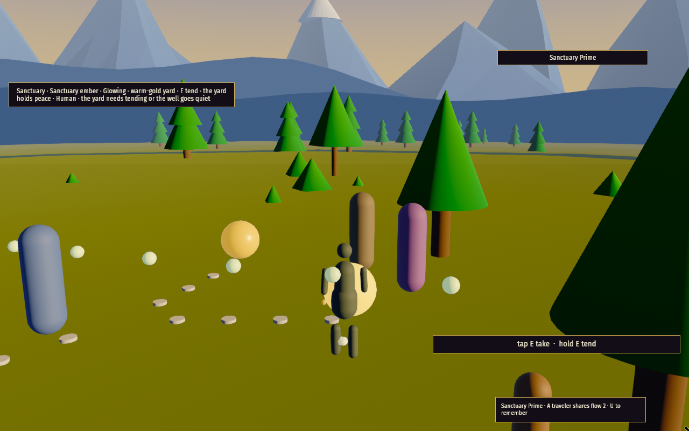
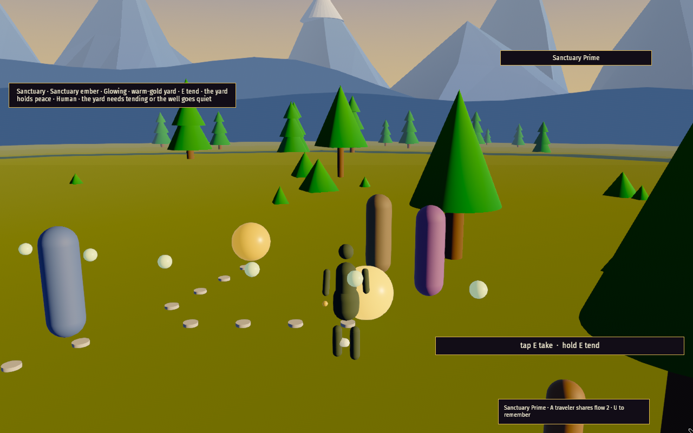
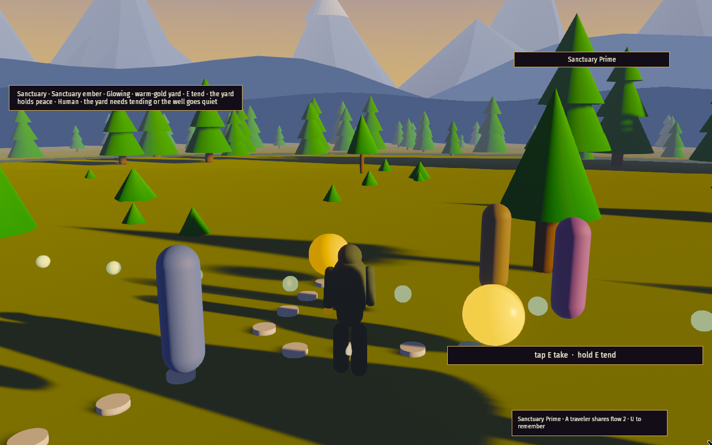
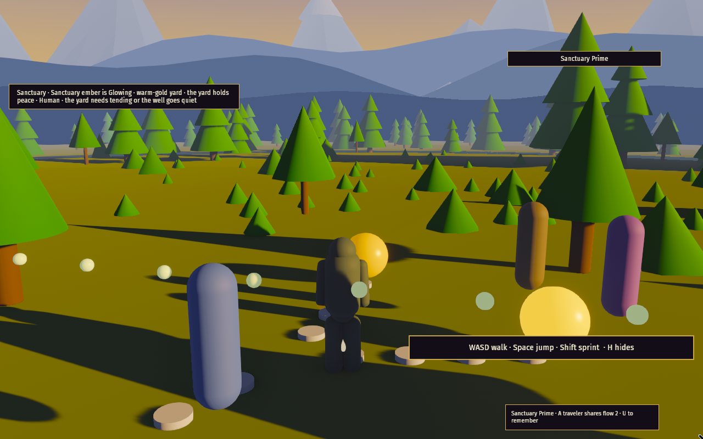
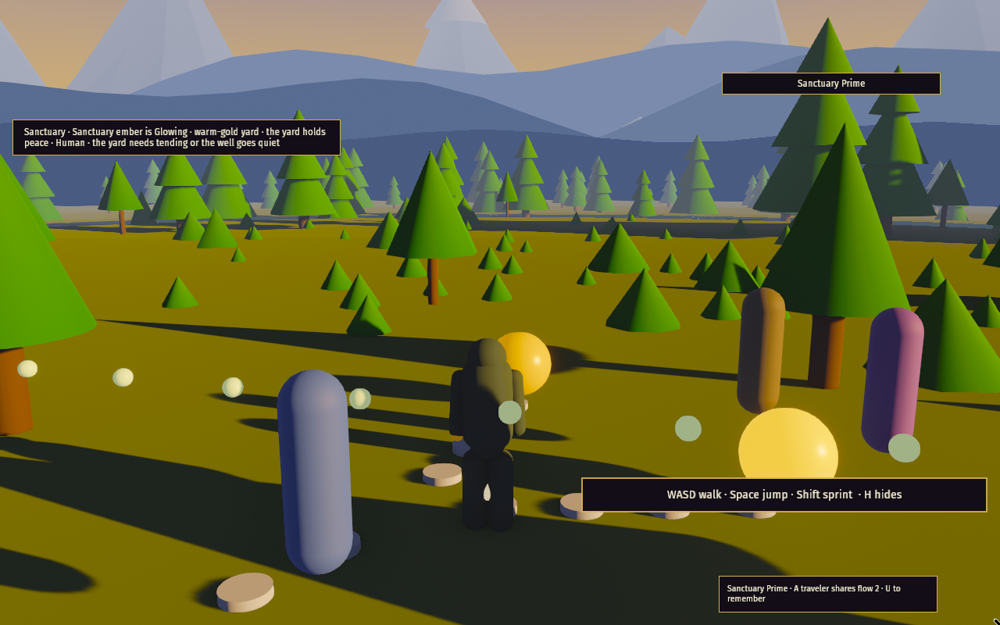
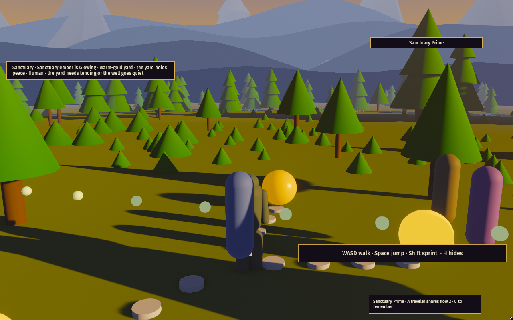
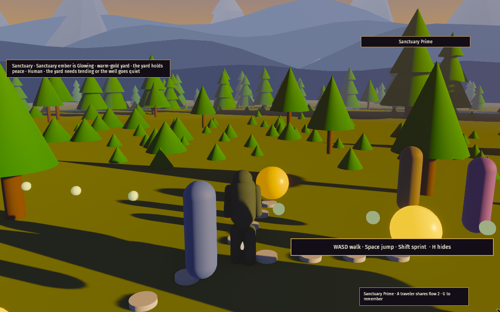

# VP-CHAR-1 — character dress/material pass

Per-preset character material response (cloth / skin / metal) so the person sits in the
shipped golden-hour grade (VP-LIGHT-1 / VP-GRADE-1) instead of reading flat. Material
only — no rig, animation, VFX, scene lighting or bloom changes. Client crate only.

Captures: release binary under Xvfb at 1280×800 on lavapipe software rendering, Online
grey, fresh settings dir per preset.

## Before / after

| Preset | Before | After |
|---|---|---|
| Low |  |  |
| Medium |  |  |
| High |  |  |
| Ultra |  |  |

## Side-by-side vs the Quellorian waterfall plate

Per card bounds the plate is **referenced by URL only** and is not committed as a binary.
The character is framed against the shipped grade in-engine (after shot) next to the
target plate.

| Quellorian waterfall plate (target, by URL) | Character in-engine, after (Medium) |
|---|---|
|  |  |

Low preset, character framed in-engine (after): 

## Per-card frame-time budget

Software numbers (lavapipe under Xvfb — not GPU); each figure is the mean of the last 10
Bevy `frame_time` lines.

| Preset | Before | After | Budget |
|---|---|---|---|
| Low | 41.5 ms | 45.1 ms | ≤ 50 ms |
| Medium | 97.2 ms | 88.9 ms | ≤ 100 ms |
| High | 194.1 ms | 200.7 ms | none (beauty tier) |
| Ultra | 363.5 ms | 341.0 ms | none (beauty tier) |

Before/after deltas are within run-to-run software noise; the pass only changes material
values.
