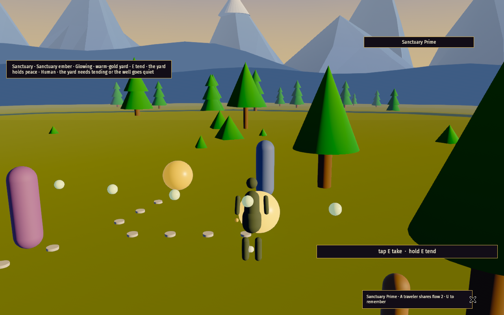
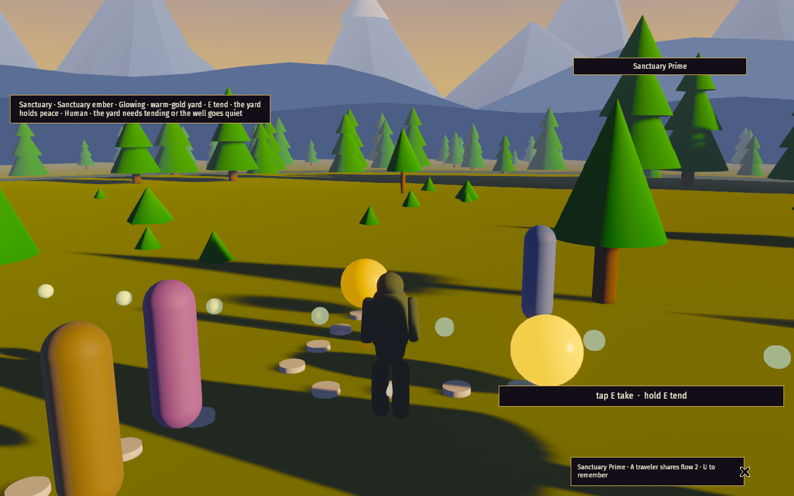
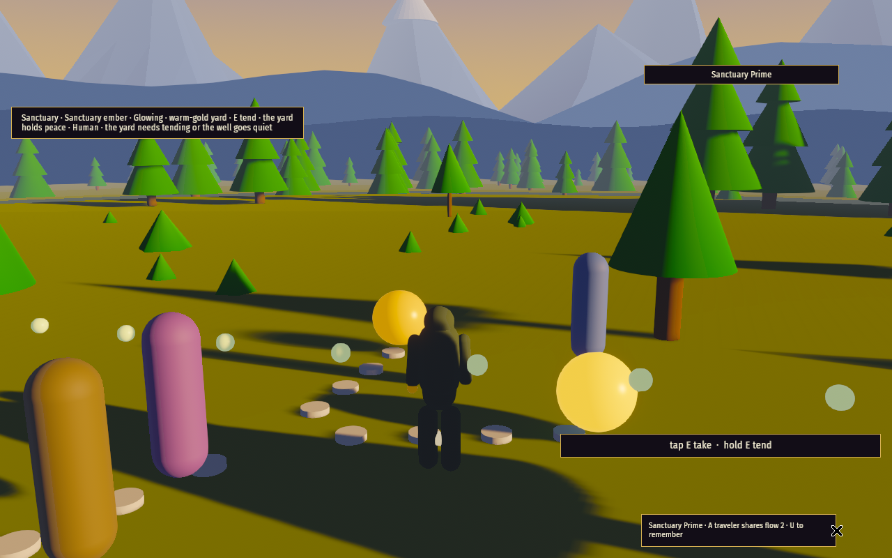
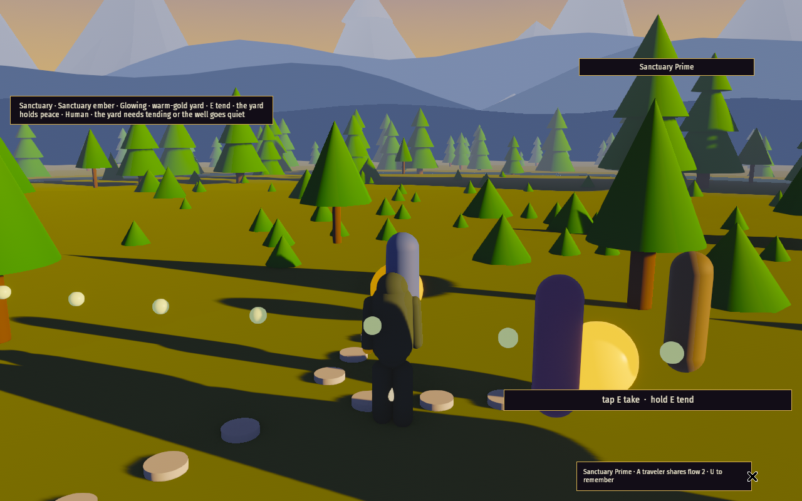
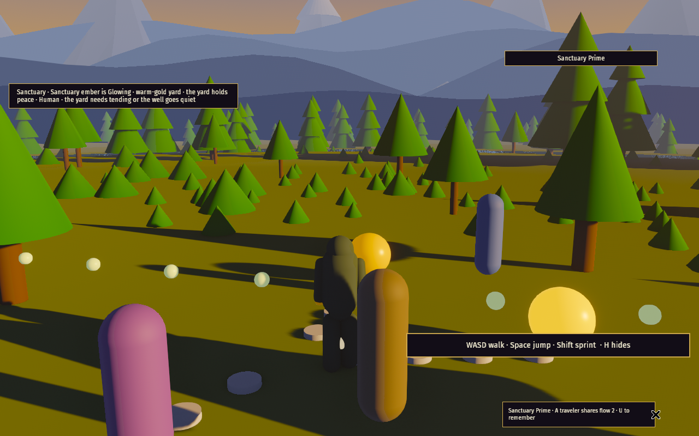
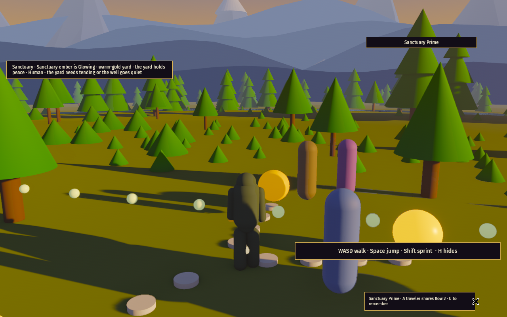

# VP-ULTRA-1 — Ultra preset as a High superset

Ultra is the top beauty tier. Wherever High already ships a feature (AO-1, AA-1, WATER-1 SSR, VEG-1), Ultra raises that same pass. Nothing is forked, and there is no second AO, SSR or AA pass. Mobile, Low, Medium and High values are unchanged, and tests pin them.

Captures: real release binaries (before = `e48f8833`, after = this branch). Each was rendered under Xvfb at 1280×800 with lavapipe software rendering, Online off and a fresh settings dir per preset. The frame was grabbed 28 s after Play (40 s on High and Ultra).

## Ultra constants

| Constant | Ultra | High (unchanged) | Where |
|---|---|---|---|
| `SSAO_QUALITY_ULTRA` / `SSAO_QUALITY_HIGH` | `Ultra` samples | `High` samples | `climate_plane.rs`, same one SSAO pass, same radius 0.62 / thickness 0.25 |
| `ULTRA_ANTI_ALIAS` | `Taa` (SMAA off) | `Smaa` | `local_settings.rs`, one AA path per camera, never stacked |
| `AERIAL_HAZE_ULTRA` | start 26 m, end 560 m | start 24 m, end 480 m | `climate_plane.rs`, same haze, longer range |
| `ULTRA_ENV_INTENSITY` / `ULTRA_ENV_FACE` / `ULTRA_ENV_ZENITH`/`HORIZON`/`GROUND` | 350 cd/m², 32² procedural cubemap | off | `ultra_env.rs`, Bevy `GeneratedEnvironmentMapLight`, no texture binary |
| (already shipped) SSR | 10 linear / 4 bisection / secant | 6 / 2 | WATER-1, untouched |
| (already shipped) vegetation | 520/120/48, reach 64 | 280/72/28, reach 48 | VEG-1, untouched |
| (already shipped) volumetric fog | on | off | `ultra_volumetric_for`, untouched |

## Before / after

| Preset | Before | After |
|---|---|---|
| Low (no change) |  |  |
| Medium (no change) |  |  |
| High (no change) |  |  |
| Ultra |  |  |

The practice travelers and capsules wander, so frames differ in where they stand. Low, Medium and High output is unchanged by code: their tier values are pinned in tests.

## Side-by-side vs the Quellorian waterfall plate

The plate is referenced by URL only and is not committed.

| Quellorian waterfall plate (target, by URL) | In-engine Ultra, after |
|---|---|
|  |  |

## Frame time (software: lavapipe under Xvfb, not GPU)

Each figure is the mean of the last 10 Bevy `frame_time` lines. Runs were interleaved before, after, before, after, before, after, and each run started only when the 1-min load was < 2.5 (8 cores).

| Preset | Before median | After median | Budget |
|---|---|---|---|
| Low | 39.6 ms | 45.9 ms | ≤ 50 ms ✅ |
| Medium | 89.4 ms | 91.1 ms | ≤ 100 ms ✅ |
| High (single run) | 221.0 ms | 187.9 ms | none |
| Ultra | 344.2 ms | 457.3 ms | none (beauty tier) |

| Run | Ultra before | Ultra after | Low before | Low after | Medium before | Medium after |
|---|---|---|---|---|---|---|
| 1 | 368.1 (2.46) | 439.8 (2.45) | 41.7 (2.34) | 50.1 (2.43) | 99.2 (2.31) | 85.7 (2.22) |
| 2 | 334.0 (2.38) | 497.6 (2.40) | 38.4 (2.32) | 45.9 (2.40) | 88.7 (2.35) | 98.1 (2.31) |
| 3 | 344.2 (2.42) | 457.3 (2.15) | 39.6 (2.48) | 39.9 (2.24) | 89.4 (2.16) | 91.1 (2.46) |

Values are ms, with the 1-min load at run start in parentheses. Low, Medium and High run no new code path, so their deltas are run-to-run noise.

## Per-feature Ultra cost (one run each, the feature toggled off in a temp build)

| Ultra build | Frame | Cost vs Ultra after median (457.3) |
|---|---|---|
| without env-map lighting | 385.1 ms | ≈ 72 ms (**most expensive**) |
| SSAO at High quality | 392.8 ms | ≈ 65 ms |
| High's haze range | 453.0 ms | ≈ 4 ms |
| SMAA instead of TAA | 493.6 ms | ≈ 0 (noise; TAA ≤ SMAA here) |

No single feature costs more than High's whole frame (188–221 ms).
