# VP-VFX-1 — capped Tend / Flow VFX

Visual feedback for the existing **Tend** (hold E at a glow) and **Flow** (allocate `1`)
answers, so they read as part of the painted world. `client/src/tend_flow_vfx.rs` only
*reads* `WorldAnswer`; Tend / Flow gameplay, timing, cooldowns and networking are
unchanged. Small unlit emissive motes (gold for Tend, pale water for Flow) spawn in the
lower third of the view, to either side of centre, rise, shrink and despawn. No particle
crate, no lighting / bloom / grade change, no rig change.

Captures: real release binaries (before = `bc9bf930`, after = this branch) under Xvfb at
1280×800 on lavapipe software rendering, Online off, fresh settings dir per preset. The
effect is triggered with real key presses on the existing bindings (E tap → Take, E hold
→ Tend, `1` → Flow on the allocate panel); one frame grabbed mid-Tend and just after Flow.

## Caps (live motes)

| Preset | Cap | Notes |
|---|---|---|
| Mobile | 0 (`VFX_CAP_MOBILE`) | off |
| Low | 6 (`VFX_CAP_LOW`) | minimal |
| Medium | 14 (`VFX_CAP_MEDIUM`) | |
| High | 24 (`VFX_CAP_HIGH`) | |
| Ultra | 24 (`VFX_CAP_ULTRA` = High) | no Ultra-only stack |

Per fire: Tend ≤ 6 motes / 1.6 s, Flow ≤ 10 motes / 2.2 s, always clamped to the cap.

## Before / after — Low and Medium

| Preset · action | Before | After |
|---|---|---|
| Low · Tend | 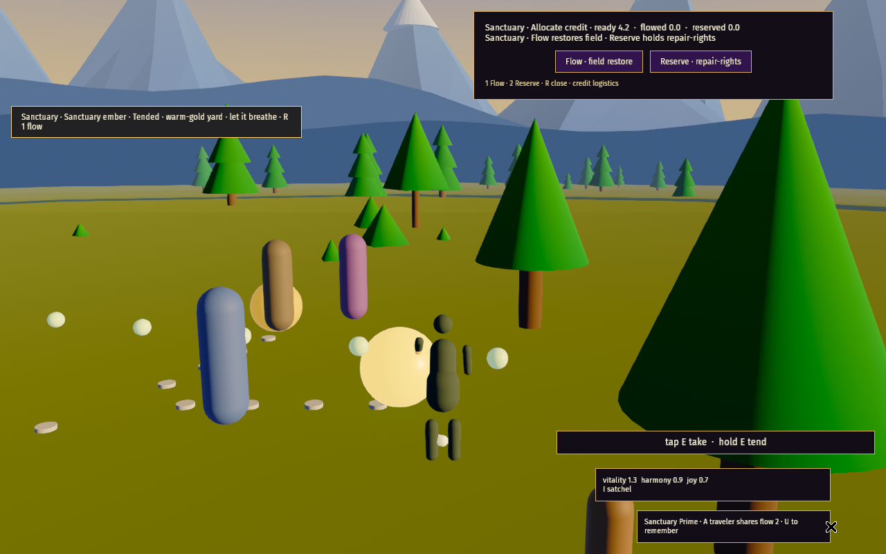 | 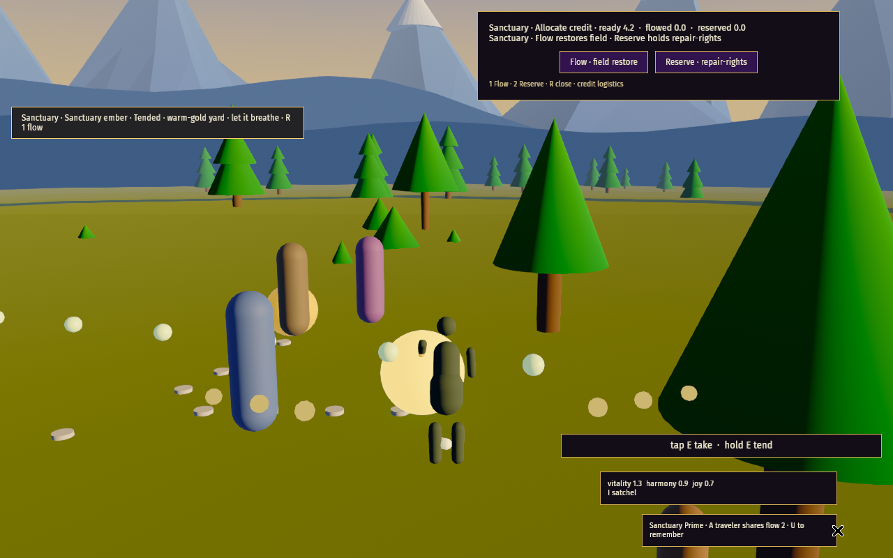 |
| Low · Flow | 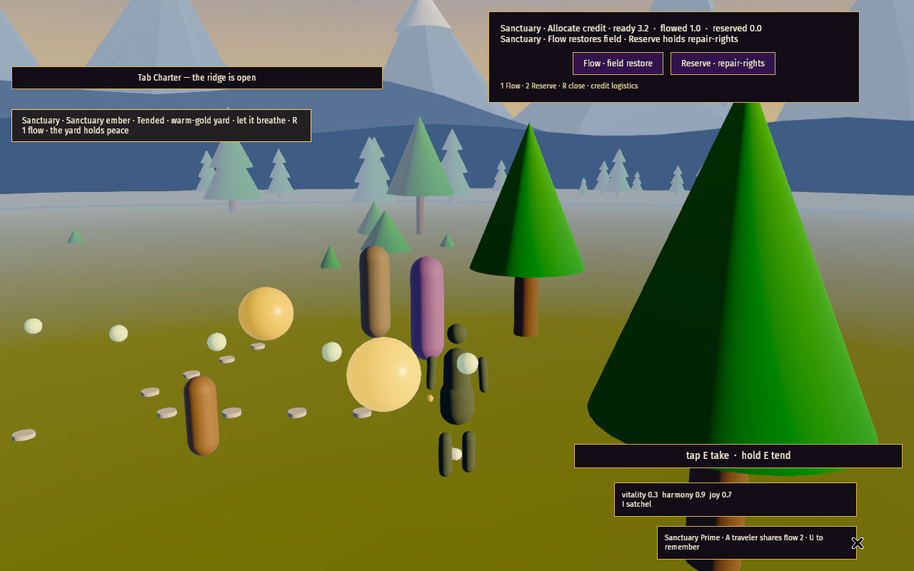 | 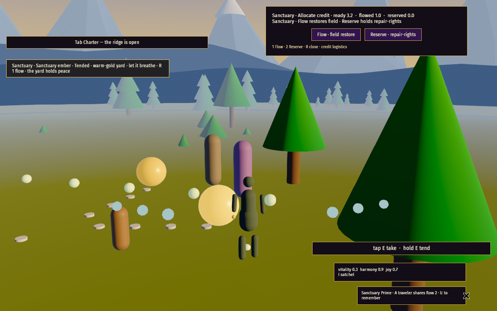 |
| Medium · Tend | 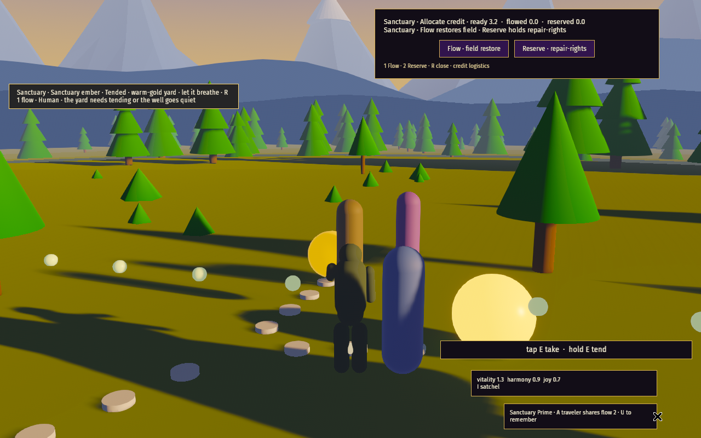 | 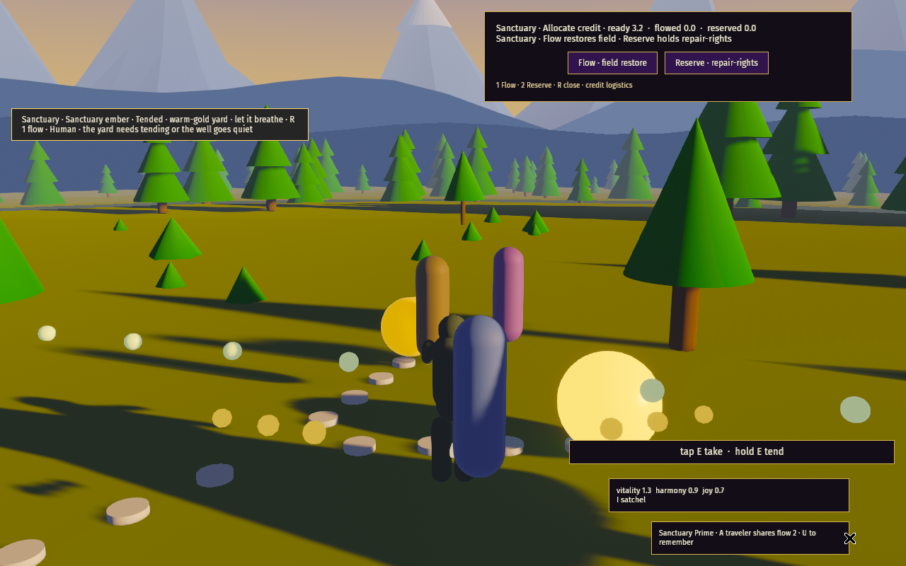 |
| Medium · Flow | 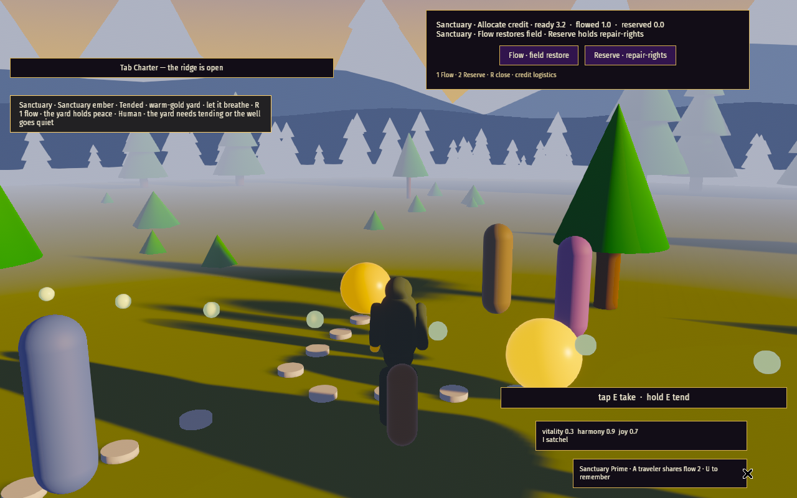 | 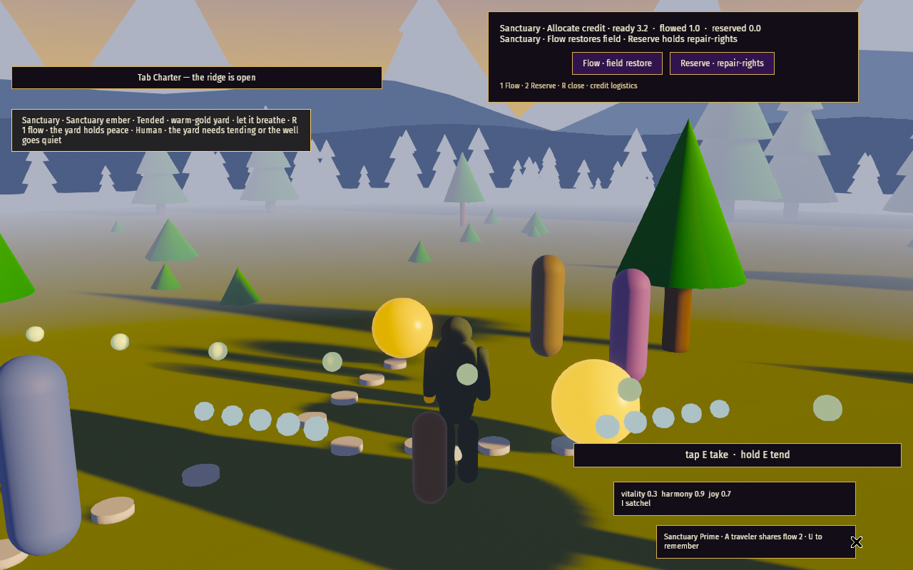 |

## High / Ultra (cap raised, still capped)

| Preset · action | Before | After |
|---|---|---|
| High · Tend | 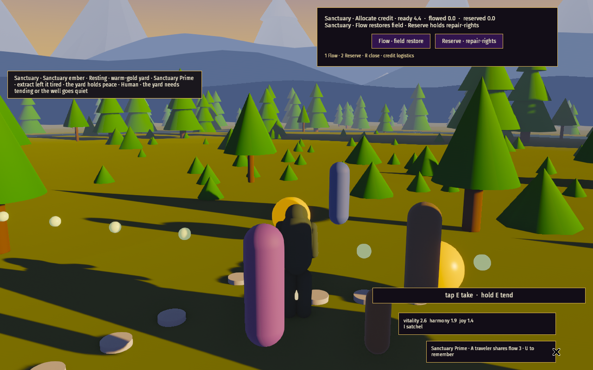 | 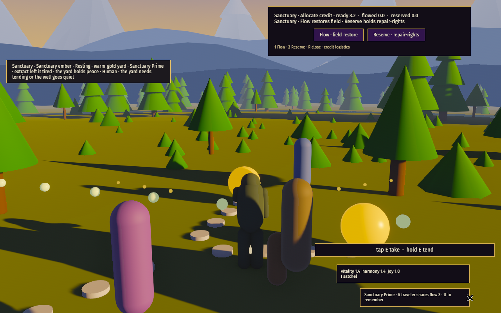 |
| High · Flow | 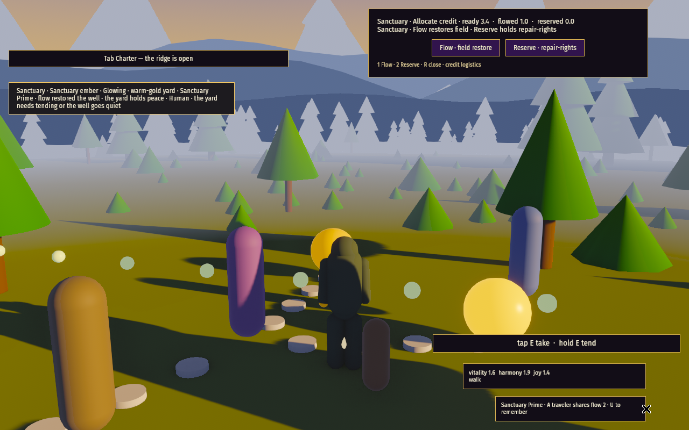 | 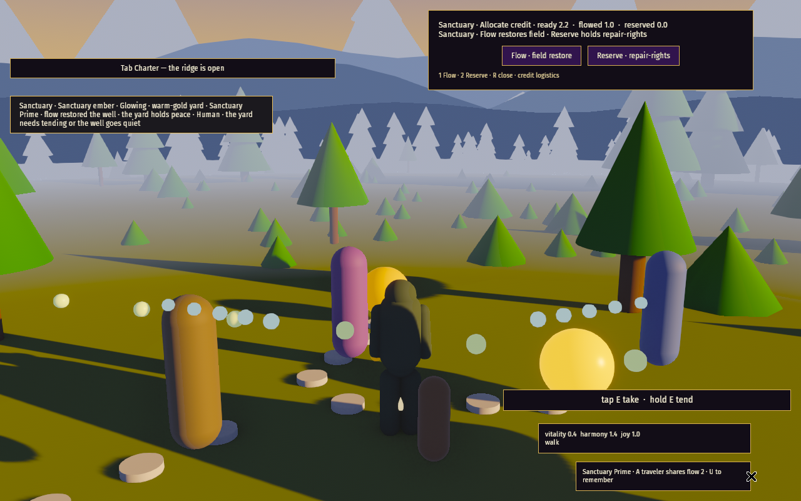 |
| Ultra · Tend | 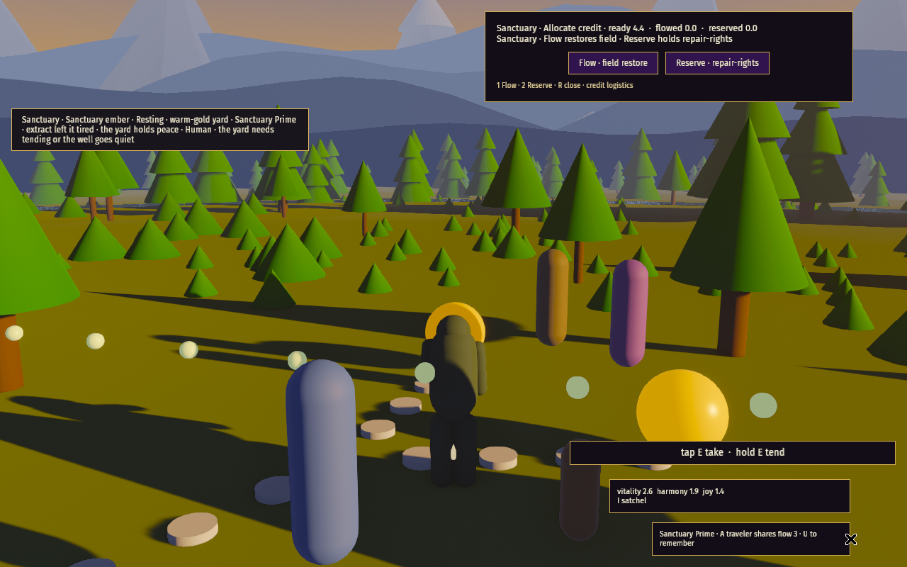 | 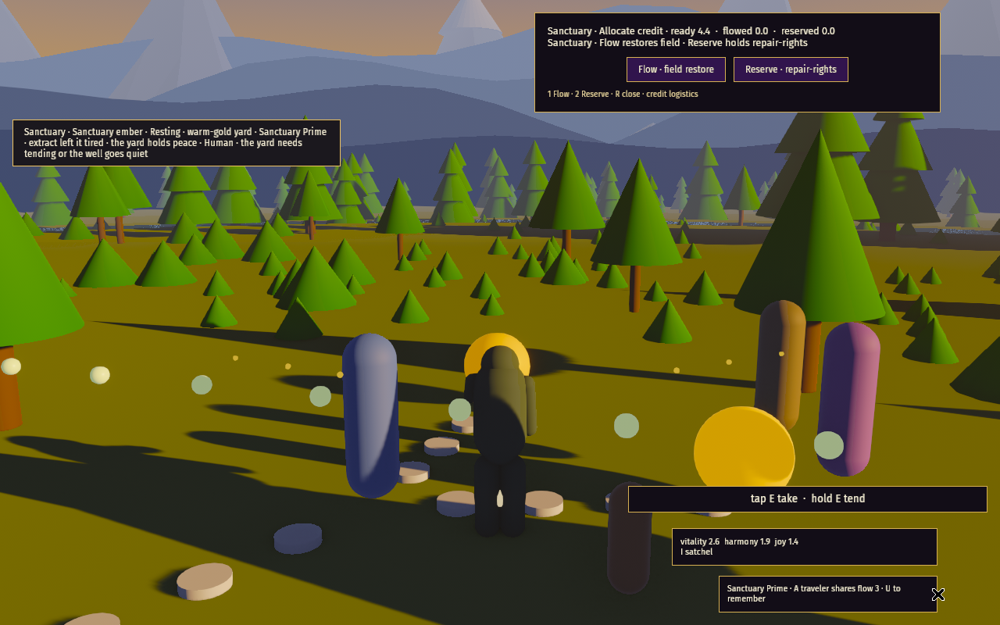 |
| Ultra · Flow | 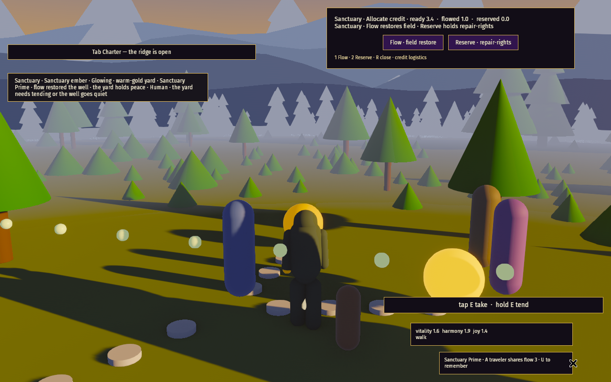 | 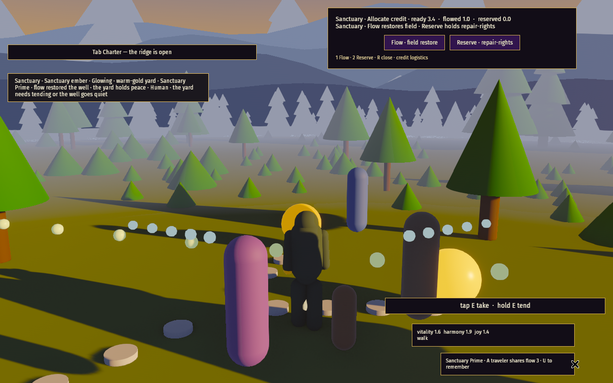 |

## Side-by-side vs the Quellorian waterfall plate

Plate referenced by URL only (not committed).

| Quellorian waterfall plate (target, by URL) | In-engine after (Medium · Flow) |
|---|---|
|  |  |

## Frame time (software — lavapipe under Xvfb, not GPU)

Mean of the last 10 Bevy `frame_time` lines per run (window includes the Tend + Flow fires).

| Preset | Before | After | Budget |
|---|---|---|---|
| Low | 45.8 ms | 48.1 ms | ≤ 50 ms |
| Medium | 93.9 ms | 95.6 ms | ≤ 100 ms |
| High | 218.8 ms | 237.0 ms | none (beauty tier, capped) |
| Ultra | 357.8 ms | 403.3 ms | none (beauty tier, capped) |

High / Ultra runs used longer settle waits (slower software frames), so their before/after
deltas include run-to-run noise.
